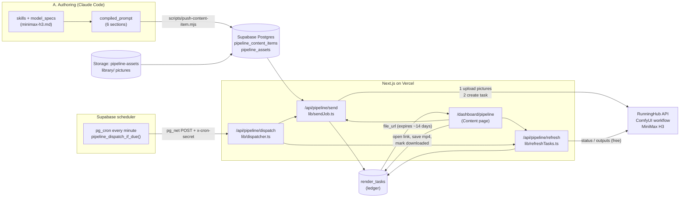
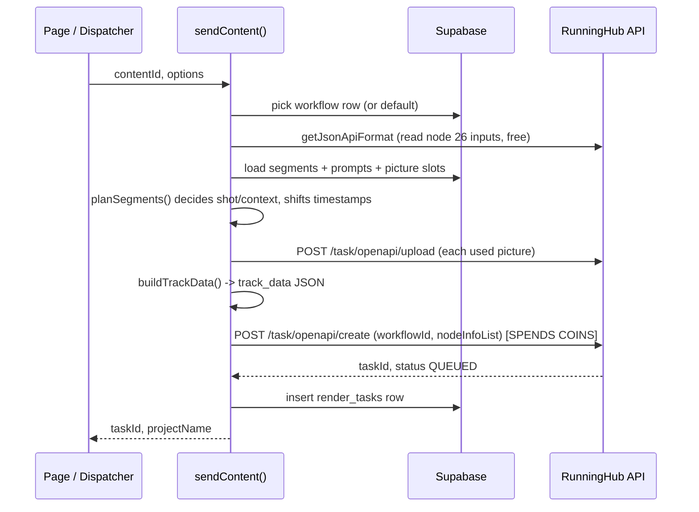
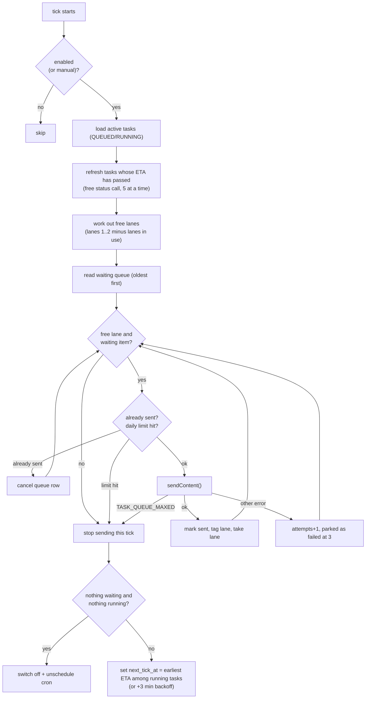

# Render Pipeline Architecture: from prompt to downloaded clip

> Audience: team members learning how our AI-video production system works. This file is written to be read by a person or summarized by an LLM. It describes the system as it exists in this repository (`lib/`, `app/api/pipeline/`, `supabase/migrations/`). It contains no secrets; all keys live in environment variables or Supabase Vault.
>
> Thai summary (สรุปภาษาไทย): ระบบนี้รับ prompt ที่เขียนเสร็จแล้วจากฐานข้อมูล ส่งเข้า RunningHub (RH) ผ่าน API เป็นงานเรนเดอร์วิดีโอด้วยโมเดล MiniMax H3 ติดตามสถานะอัตโนมัติด้วย dispatcher ที่ทำงานบน Supabase pg_cron แล้วให้ทีมกดโหลดคลิปจากหน้า Content ภายใน 14 วันก่อนลิงก์หมดอายุ

---

## 1. What the system does

One **content item** (for example one 10-30 second Thai UGC clip) goes through five stages:

| # | Stage | Where it happens | Output |
|---|---|---|---|
| A | **Author** the prompt (MiniMax H3 "Ref2VA" format) | Claude Code skills + `model_specs/minimax-h3.md` | `compiled_prompt` text |
| B | **Store** prompt and pick reference pictures | Supabase tables + Storage bucket `pipeline-assets` | rows in `pipeline_content_items`, `pipeline_assets` |
| C | **Send** to RunningHub | `lib/sendJob.ts` via `/api/pipeline/send` or the dispatcher | a RunningHub `taskId` + a row in `render_tasks` |
| D | **Track** status | `lib/refreshTasks.ts`, `lib/dispatcher.ts` | `render_tasks.status` = QUEUED, RUNNING, SUCCESS, FAILED, CANCELLED |
| E | **Collect** the finished clip | Content page link + local script | video file saved, `downloaded = true` |

The one rule that shapes the whole design: **sending a job spends money (RunningHub coins)**, reading status does not. So every path that sends is protected by confirmation, and every status path is read-only.

---

## 2. Tech stack

| Layer | Technology | Notes |
|---|---|---|
| Web app and API | **Next.js 16** (App Router), **React 19**, **TypeScript 5**, **Tailwind 4** | Route handlers under `app/api/`; dashboard under `app/dashboard/` |
| Hosting | **Vercel** | Server routes have `maxDuration = 60` s; all server secrets are Vercel env vars |
| Database / storage / scheduler | **Supabase** (Postgres, Storage, `pg_cron`, `pg_net`, Vault) | Service-role key is used server-side only; RLS is on, no public policies |
| Video generation | **RunningHub (RH)** hosting a ComfyUI workflow | Model: **MiniMax H3** (reference-to-video+audio). The workflow uses the **Easy-Media** multi-track editor node |
| Alternative GPU provider | **RunPod** (own ComfyUI pod) | Same model, different transport (see section 10); used when RH credit is not wanted |
| Prompt authoring | **Claude Code** skills (`.claude/skills/`) | Characters, content DNA, format bibles, validators |
| Voice / audio (separate step) | Gemini TTS, ElevenLabs | Audio is produced outside the render job and mixed in editing, see section 11 |
| Notifications / extras | Telegram bot, Gemini API (`lib/gemini.ts`) | Legacy image pipeline; not part of the video render path |
| Local tooling | Node.js scripts (`scripts/`, `.claude/skills/comfyui-runpod-batch/scripts/`), `ffmpeg` | Bulk push of prompts, local collect of clips |

Key libraries: `@supabase/supabase-js`, `node-cron` (legacy local worker), `sharp`, `pdf-lib`. The RH client is written with plain `fetch` (no SDK).

---

## 3. Architecture at a glance



Design principles:

1. **Database is the source of truth.** Prompts, pictures, queue, task ledger and dispatcher settings are all Postgres rows. The app is stateless, so a serverless timeout never loses work.
2. **One RunningHub task per content item.** All segments of a content go into one task (one `track_data` JSON with N segments). Repairs re-render a subset of segments as a separate task.
3. **Two lanes.** RunningHub runs 2 tasks at once for our account. The dispatcher models that as lanes 1 and 2.
4. **ETA-based polling, not constant polling.** Status is asked only when a task should be nearly done (section 7).
5. **Fail safe with money.** Confirmation flag, dry-run, no double-send, 3-strike parking, optional daily cap, admin token.

---

## 4. Data model (Supabase)

All tables have RLS enabled with **no policies**: only the service-role key (server routes and local scripts) can read or write them.

| Table | Purpose | Important columns |
|---|---|---|
| `pipeline_content_items` | One row per content. Main row = segment 1. Segments 2..N point to it | `title`, `character`, `compiled_prompt`, `segment_number`, `parent_content_item_id`, `status`, `note` (JSON of render settings), `scheduled_date` |
| `pipeline_assets` | Pictures. Slot pictures belong to a content; library pictures have `content_item_id = null` and `asset_type = 'reference'` | `url`, `label`, `picture_slot` (1..3, contiguous), Storage path under `library/` |
| `render_tasks` | **Ledger**: one row per RunningHub (or RunPod) job | `provider`, `job_id` (RH taskId), `content_item_id`, `seg_from`, `seg_count`, `status`, `submitted_at`, `running_at`, `finished_at`, `run_seconds`, `coins`, `file_url`, `downloaded`, `lane`, `seed`, `note` (JSON) |
| `pipeline_render_workflows` | Which RH workflow to use and its node ids | `workflow_id`, `node_editor` (track_data node), `node_project` (project name/seed node), `megapixel_mode`, `is_default` |
| `pipeline_send_queue` | Waiting list for the dispatcher | `content_item_id`, `status` (waiting, sent, failed, cancelled), `attempts`, `last_error`, `opts` (repair options) |
| `pipeline_dispatcher_settings` | Single row (id = 1) | `enabled`, `lanes` (default 2), `daily_limit`, `next_tick_at`, `site_url`, `last_note` |
| `pipeline_dispatch_log` | One row per dispatcher tick | `active_before`, `sent`, `queue_maxed`, `note` |
| view `render_todo` | Contents that have no SUCCESS render yet | |

Storage bucket: `pipeline-assets` (reference pictures, library, outfit/background catalogs).

The `note` column on the main content row stores per-content render settings as JSON: `resolution`, `continuity` (per segment), `authored` (how each segment's text was written), `segImages` (which picture slots each segment uses), `frames`.

Migrations live in `supabase/migrations/`; the pipeline ones start with `20260829...` and the dispatcher/lane ones are `20261019...`.

---

## 5. Stage A: authoring the prompt (what gets stored)

The prompt for MiniMax H3 (mode **Ref2VA**, full reference) has six sections in this order:

```
subject_definitions:     who/what each <Picture N> is
summary:                 [reference generation] A new shot: ...
retention_analysis:      what to keep from each picture (fully_preserved) 
detailed_description:    [Shot 1] ... [Shot 2] At 00:02.700 ... timed shots, <d>dialogue</d>
overall_soundscape:      ambient sound
non_diegetic_music:      N/A or description
```

Rules the team follows (full details in `model_specs/minimax-h3.md`):

- Pictures are referenced as `<Picture N>` directly in prose. Picture 1 = character, Picture 2 = outfit, Picture 3 = place/background (a catalog of outfits and backgrounds is stored under `library/`).
- Timeline is 24 fps. A segment of 192 frames = 8 seconds. Shots carry timestamps (`At 00:02.700`), and shots should be at least about 1.2 s apart.
- Camera is described by framing, level, and height ("camera at chest height"), never by gear (phone, tripod).
- Segments longer than the generation limit are split into several prompts (segment 1 is a "shot" segment; later ones can be "context" segments that continue from the previous one, with timestamps shifted by 0.917 s).
- A prompt must say what each picture contributes **and** what it must not contribute (for example "only the outfit is taken from Picture 2"), otherwise the model mixes things in.

How prompts get into the database:

1. Skills in `.claude/skills/` (`content-request`, `content-director`, `format-router`, `prompt-enhancer`, `comfyui-compiler`, `prompt-validator`) turn an idea plus character DNA (`characters/`, `content_dna/`, `format_bibles/`) into a compiled prompt. The validator runs as a fresh sub-agent so it does not trust the context that wrote the prompt.
2. `scripts/push-content-item.mjs` inserts the content (and later segments with `parent_content_item_id`) into `pipeline_content_items`.
3. The team picks pictures on the Content page (slots 1..3, from the library or an upload); this writes `pipeline_assets` rows.

---

## 6. Stage C: sending to RunningHub (`lib/sendJob.ts`)

Entry points: the **Send** button (`POST /api/pipeline/send`) and the **dispatcher** (section 7). Both call `sendContent()`.

### 6.1 Call sequence



### 6.2 What is sent

`rhCreate(workflowId, nodeInfoList)` receives:

| Node | Field | Value |
|---|---|---|
| `node_editor` (default 26 in the current workflow; stored per workflow) | `track_data` | The Easy-Media multi-track JSON built by `buildTrackData()` |
| `node_editor` | `resolution` (+ `resolution.aspect_ratio`, `resolution.megapixels` in megapixel mode) | Default 720 x 1280 (9:16), or the saved value; "workflow" means send nothing and keep the workflow's own value |
| `node_project` | `project_name` | Unique per content (`<slug>_<6 chars of id>`), repairs get `_seg2_fix1` style suffixes |
| `node_project` | `seed` | Random 48-bit integer, also stored in `render_tasks.seed` |

The `track_data` JSON contains one **task track** with N segments. For each segment: `start_frame`/`end_frame` (24 fps), `task_mode: "ref"`, `ref_image_size: "max"`, `continuity_mode` (`shot` or `context`), the uploaded picture names (`images[]`), and `user_prompt` (the compiled prompt starting at `subject_definitions:`).

### 6.3 Things the sender does for you

- **Picture upload:** each picture URL is fetched and uploaded to RunningHub (`/task/openapi/upload`); RH returns a file name that is placed in `track_data`. Only pictures actually used by a segment are uploaded (`segImages`).
- **Continuity:** segment 1 is always `shot`. Other segments default to `context`. If a segment was written as context but is rendered as a shot (for example a repair), its timestamps are shifted back by 0.917 s.
- **Workflow drift protection:** the workflow owner can re-save the RH workflow at any time. Before creating a task, the sender reads the live node inputs (`rhWorkflowNodeInputs`) and chooses the right resolution field style, avoiding a `NODE_INFO_MISMATCH` failure.
- **Dry run:** `POST /api/pipeline/send` with `dryRun: true` builds everything and returns a preview (modes, shifted timestamps, resolution, pictures used) without uploading or creating a task. Costs nothing.
- **Repairs:** `segFrom` + `segCount` (+ optional replacement `prompt`) render only some segments as a new task, for fixing one bad segment.

### 6.4 Failure behavior

- If RH creation fails, the error is wrapped as `SendError`. The message `TASK_QUEUE_MAXED` is detected (`queueMaxed`) so the dispatcher can back off instead of retrying immediately.
- If the task was created at RH but writing the ledger row fails, the error message includes the `taskId` so the job is not lost.

---

## 7. Stage D: dispatcher and status tracking

### 7.1 Why a dispatcher

A 24-second clip can take about 11 minutes of GPU time, and we run 2 at once. Instead of someone watching, the team **queues** contents ("เข้าคิวส่งที่เลือก") and switches the dispatcher on. It keeps both lanes busy and turns itself off when work is finished.

### 7.2 Scheduling mechanism (`pg_cron` + `pg_net`)

1. Turning the dispatcher on calls the SQL function `pipeline_dispatcher_schedule(true, <site url>)`, which creates a `pg_cron` job `pipeline-dispatch` running **every minute**.
2. Every minute the function `pipeline_dispatch_if_due()` does a cheap SQL check: is `enabled` true and is `next_tick_at` due? Only then does it call the app with `pg_net` (`POST <site>/api/pipeline/dispatch`) and header `x-cron-secret`.
3. The secret is stored in **Supabase Vault** (`pipeline_cron_secret`) and checked by `pipeline_verify_cron_secret()`. It is not in Vercel env vars.
4. The route has two auth paths: cron secret (automatic) or `x-admin-token` (manual "run now" button).
5. The dispatcher can only be switched on from the deployed https site (the database has to reach it), not from localhost.

### 7.3 One tick (`runTick` in `lib/dispatcher.ts`)



### 7.4 ETA model (`lib/trackData.ts`)

- Measured rate: about **27 seconds of run time per second of video** (`RUN_SEC_PER_VIDEO_SEC = 27`), roughly **5.5 coins per video second** (`estimate()`).
- First status check at **85%** of the estimated run time (`CHECK_AT = 0.85`), never earlier than 120 s after submission. After the ETA passes, re-check every 90 s.
- Example: a 3-segment (24 s) task is first checked after about `3 * 8 * 27 * 0.85 = 550` s.

### 7.5 Status refresh (`lib/refreshTasks.ts`)

For each active task: `POST /task/openapi/status` returns `QUEUED | RUNNING | SUCCESS | FAILED`. The ledger is updated with timestamps (`running_at`, `finished_at`). On `SUCCESS` the code also calls `/task/openapi/outputs` and stores `file_url`, `run_seconds` (RH `taskCostTime`) and `coins` (RH `consumeCoins`). Nothing here submits or cancels, so it is free. The page's manual "refresh" button does the same, limited to 5 tasks per request to stay inside serverless time limits.

### 7.6 Safety rules in the dispatcher

- A content is never sent twice (checks existing QUEUED/RUNNING/SUCCESS tasks for segment 1; repairs carry `opts` and are deliberate).
- An item that fails 3 times is parked as `failed`.
- The number of lanes (2) is the real cap on parallel sends, and the optional `daily_limit` caps sends per UTC day. (`max_per_tick` exists in the settings table but the current tick code does not read it.)
- Every tick is written to `pipeline_dispatch_log` (used to learn the real queue limit).
- "ปิดตัวส่งอัตโนมัติ" switches it off and removes the cron job at any time.

---

## 8. Stage E: collecting and using the clip

1. When a task reaches `SUCCESS`, the Content page shows **"เสร็จ · รอโหลด"** and a link ("โหลดคลิป") to `render_tasks.file_url`.
2. **RunningHub keeps result files for about 14 days.** The page counts the days left from the submit time (`RETENTION_DAYS = 14`) and lists urgent undownloaded clips first.
3. The team opens the link, saves the mp4, then marks it downloaded (`PATCH /api/pipeline/task`, field `downloaded`, optional `local_path`). This does not touch RunningHub.
4. For bulk work there is a local path: `.claude/skills/comfyui-runpod-batch/scripts/` (`runninghub_run.mjs --status`, `--collect`) downloads the clips into the story folder and writes run time/coins/cost into the ledger. A local ledger file `rh_tasks.json` is a backup if Supabase is unreachable (`--sync-ledger` pushes it back).
5. After download: quality check (a contact sheet made with `ffmpeg`), then editing. H3 clips are silent or carry only generated ambience in some modes; voice-over is usually mixed in the edit.

---

## 9. Security and cost controls (summary)

| Control | Where |
|---|---|
| Sending needs `confirm: true` in the request | `/api/pipeline/send` |
| Dry run shows exactly what would be sent, free | `sendContent({dryRun:true})` |
| `PIPELINE_ADMIN_TOKEN` required (header `x-admin-token`) on all write routes when set | `lib/adminGuard.ts` |
| Cron route authenticated by Vault secret, not a Vercel env var | `pipeline_verify_cron_secret()` |
| RLS on, no policies, anon/authenticated revoked on pipeline tables | migrations |
| RunningHub key only in server env `RUNNINGHUB_API_KEY`; error messages scrub it | `lib/runninghub.ts` (`scrub`) |
| No double send, 3 attempts max, daily cap, per-tick cap | `lib/dispatcher.ts` |
| Dispatcher cannot be enabled from localhost | `validSiteUrl()` |

Environment variables used by the render path: `NEXT_PUBLIC_SUPABASE_URL`, `SUPABASE_SERVICE_ROLE_KEY`, `RUNNINGHUB_API_KEY`, `PIPELINE_ADMIN_TOKEN`, and the legacy fallbacks `RUNNINGHUB_WORKFLOW_ID`, `RH_NODE_EDITOR`, `RH_NODE_PROJECT`. Never commit values.

---

## 10. API surface

| Route | Method | Purpose | Costs coins? |
|---|---|---|---|
| `/api/pipeline/overview` | GET | Contents, tasks, queue, dispatcher state for the page | no |
| `/api/pipeline/library` | GET, POST, PUT, PATCH, DELETE | List, upload, edit, remove library pictures | no |
| `/api/pipeline/slot` | POST | Assign a picture to a content slot | no |
| `/api/pipeline/segment` | PATCH | Save an edited segment prompt | no |
| `/api/pipeline/content-settings` | PATCH | Resolution, continuity, authored, segImages | no |
| `/api/pipeline/items` | GET, POST | List/create content items | no |
| `/api/pipeline/assets` | GET, POST | Pictures attached to contents | no |
| `/api/pipeline/schedule` | PATCH | Set scheduled date/time of a content | no |
| `/api/pipeline/workflows` | GET, POST, PATCH, DELETE | Manage RunningHub workflow rows | no |
| `/api/pipeline/queue` | GET, POST, PATCH, DELETE | Manage the send queue and switch the dispatcher on/off | no |
| `/api/pipeline/dispatch` | POST | One dispatcher tick (cron or manual) | **yes, when it sends** |
| `/api/pipeline/send` | POST | Send a content (or segment subset) | **yes** |
| `/api/pipeline/refresh` | POST | Ask RH for status of up to 5 tasks | no |
| `/api/pipeline/task` | PATCH | Mark a task downloaded | no |

RunningHub endpoints used (`lib/runninghub.ts`): `/task/openapi/upload`, `/task/openapi/create`, `/task/openapi/status`, `/task/openapi/outputs`, `/api/openapi/getJsonApiFormat`.

---

## 11. Alternatives and neighbouring systems

- **RunPod path:** same model on our own pod. Scripts (`runpod_render.mjs`) use the ComfyUI HTTP API (`/upload/image`, `/prompt`, `/history`, `/view`) and an API-format graph exported from the pod. Cost is GPU rent time; the pod must have `sageattention` built for the pod's GPU architecture. Not wired into the dashboard dispatcher; used from the command line. Legacy library code: `lib/runpod.ts`, `lib/comfyui.ts`.
- **Audio:** TTS (Gemini or ElevenLabs) is generated separately and mixed in editing. Feeding audio into the H3 workflow as a reference was tested; a RunningHub node bug (`audio.get("waveform")` returning None) was reported to RH and was awaiting a fix at the time of writing.
- **Other modules in this repo** that are not part of the video render path: the older image pipeline (phases 1-5, `jobs/`, `lib/gemini.ts`, Supabase edge function `process-phase2-batch`), an Etsy book generator (`app/api/etsy/`), Telegram notifications.

---

## 12. Known limits and gotchas

- **Concurrency:** the web/UI path runs 2 tasks at once; a Personal-tier API key was observed to allow 1. The dispatcher assumes 2 lanes and backs off on `TASK_QUEUE_MAXED`.
- **Picture slots:** the page and `parseRenderSettings` support slots 1..3 (Picture 1 character, 2 outfit, 3 place). More pictures need code changes.
- **Result expiry:** about 14 days; download early. The 14-day figure is an owner observation, not a documented RunningHub guarantee.
- **Costs are estimates:** about 27 s run per video second and about 5.5 coins per video second were measured on finished tasks; they vary with load and resolution.
- **Workflow re-saves:** if the RH workflow's node layout changes, update the node ids on the workflow row (page button "Workflow"). The sender detects the resolution style automatically but not renamed nodes.
- **Windows tooling:** Node scripts may print a libuv assertion on exit after a fetch; this is cosmetic.

---

## 13. Repository map (render-related)

```
lib/runninghub.ts        RH HTTP client (status, outputs, upload, create, read workflow graph)
lib/sendJob.ts           sendContent(): build + send one task, write ledger
lib/trackData.ts         track_data builder, timestamp shifting, resolution, ETA/cost estimates
lib/dispatcher.ts        two-lane dispatcher tick, queue, settings, cron secret check
lib/refreshTasks.ts      read-only status refresh into render_tasks
lib/adminGuard.ts        x-admin-token check
app/api/pipeline/*       routes listed in section 10
app/dashboard/pipeline/  Content page (prompts, pictures, send, status, download)
supabase/migrations/     tables, cron functions (20261019* are dispatcher/lane migrations)
model_specs/minimax-h3.md  prompt format source of truth
characters/, content_dna/, format_bibles/, platform_specs/  authoring knowledge base
.claude/skills/          content pipeline skills (request, director, router, enhancer, compiler, validator)
scripts/push-content-item.mjs  push a compiled prompt (and segments) into Supabase
docs/PIPELINE_WEB.md     operator notes for the Content page
```

---

## 14. Glossary

- **RH / RunningHub:** hosted ComfyUI service that runs our MiniMax H3 workflow and bills in coins.
- **Content item:** one video job; its main row is segment 1.
- **Segment:** a chunk of the timeline (default 8 s = 192 frames at 24 fps). A content can have several.
- **Shot vs context:** a *shot* segment starts a fresh scene; a *context* segment continues from the previous segment's last frames (timestamps shift by 0.917 s).
- **Ref2VA:** MiniMax H3 mode that takes reference pictures (and optional audio) to generate video with audio.
- **track_data:** the JSON the Easy-Media node uses to define segments, pictures and prompts.
- **Lane:** one of two parallel render slots the dispatcher fills.
- **Ledger:** the `render_tasks` table, the record of every job and its cost.
- **ETA tick:** the dispatcher only calls the app when a task should be nearly finished, not on a fixed interval.
